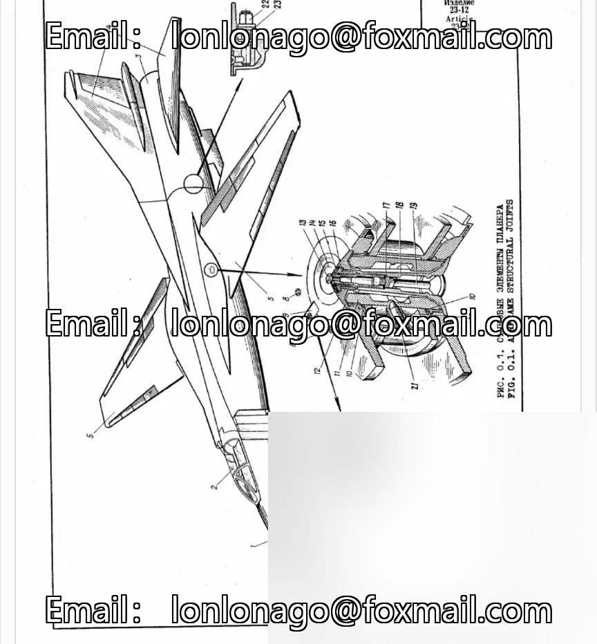
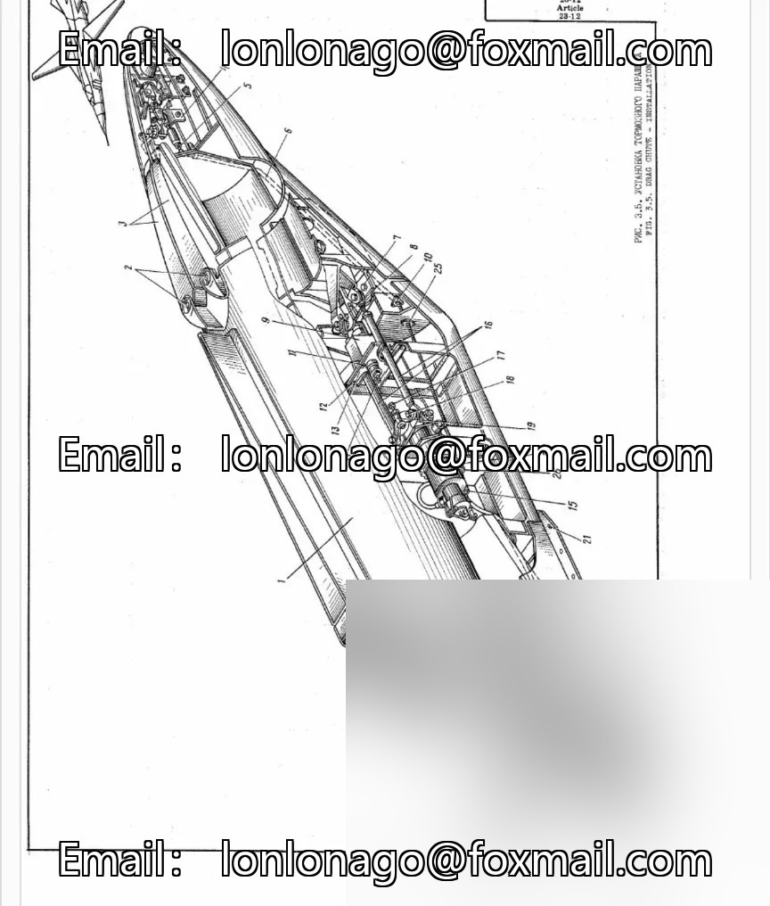
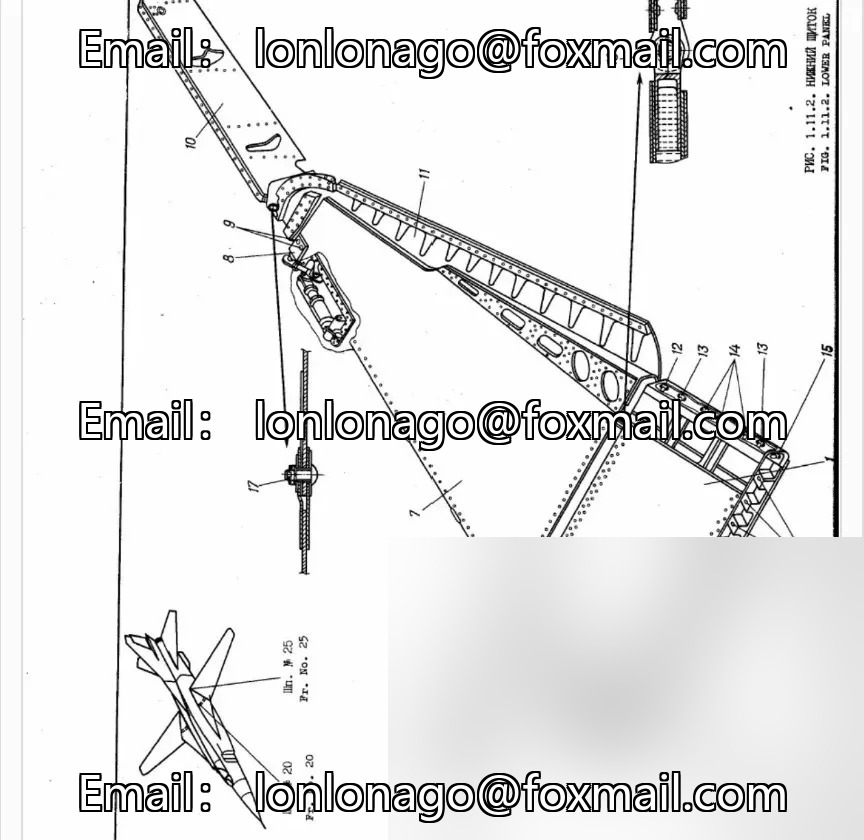

# Mig-23ML design material drawing

## Body

MIG-23ML design material drawings, developed by the Soviet MiGkafolit Design Bureau, consisting of MiG-23ML (MiG-23ML) aft-receding-wing fighter aircraft design data and document files as PDF electronic versions, 360 pages, including detailed drawings such as structure, systems, and layouts, suitable for model making, technical research, and military enthusiasts' reference.
This aircraft is a MiG-23ML (MiG-23ML) aft-receding-wing fighter aircraft developed by the Soviet MiGkafolit Design Bureau (NATO code: "Flogger-G" / Flogger-G).

37996

The material drawings include MiG-23ML variable swept-wing fighter design files, covering detailed structural, system and layout drawings; they are suitable for model making, technical research and military enthusiast reference.

<!-- AI_ENRICHED -->

## Images

## Payment

Here is a pay link on Stripe ( https://buy.stripe.com/3cs8yP7sY87d0vu9AB ). Please contact me lonlonago@foxmail.com after funding $89, and I will send you a complete data files , thank you!

